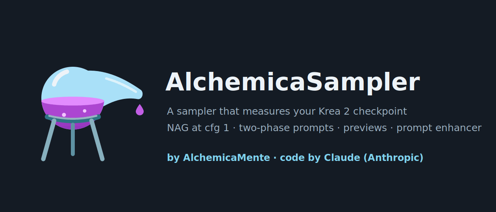
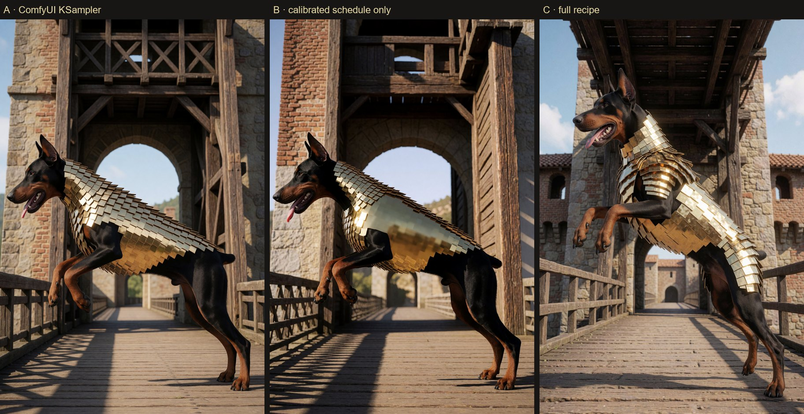
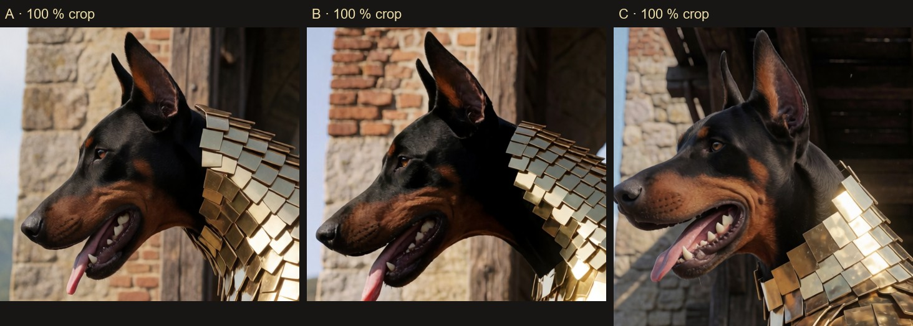
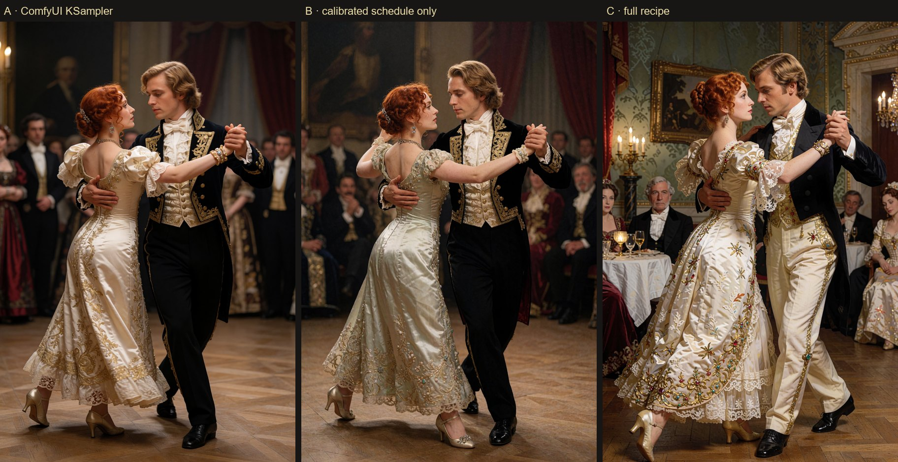
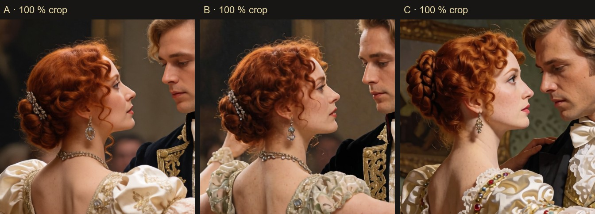
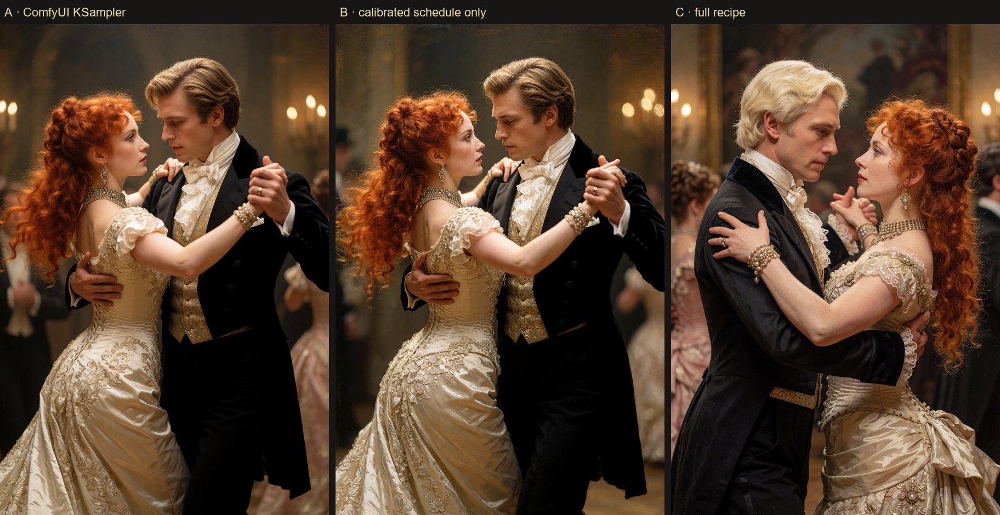
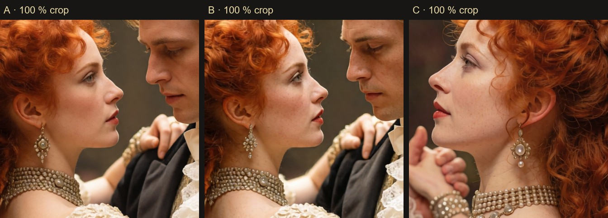

<p align="center">
  
</p>

<h1 align="center">⚗ AlchemicaSampler</h1>

<p align="center">
  <b>A complete Krea 2 toolkit for ComfyUI: one clean line from checkpoint to saved image,<br>
  plus a sampler that measures your checkpoint instead of guessing.</b>
</p>

<p align="center">
  <a href="https://github.com/Nessuno76/ComfyUI-AlchemicaSampler/releases/latest"></a>
  
  
  <a href="README_IT.md"></a>
</p>

<p align="center">
  ⚗ Idea and direction: <b>AlchemicaMente</b> · code: <b>Claude (Anthropic)</b> ·
  <a href="CREDITS.md">credits & thanks</a>
</p>

---

## ⚗ Five nodes, one straight line

Most Krea 2 graphs are a tangle of loaders, text encoders, patches and samplers. The starter workflow here is
five nodes in four coloured groups, with the model, the text encoder and the VAE travelling *through* the chain
instead of being wired to every node:

```
Load Krea 2  →  LoRA Stack  →  Prompt  →  KSampler Flex  →  Save Image
```

| Step | Node | What it saves you |
|---|---|---|
| 1 | **⚗ Load Krea 2** | model + text encoder + VAE in one node, the encoder always loaded with the right type |
| 2 | **⚗ LoRA Stack** | six LoRAs in one node, a readable list of what is active and what was not found |
| 3 | **⚗ Prompt** | writes the prompt with Krea 2's own encoder (or Ollama, or your own text), encodes it, applies NAG, sets the latent size |
| 4 | **⚗ KSampler Flex** | any ComfyUI sampler and scheduler, or the calibrated ones; two stages; DeGrid; a report of what it did |
| 5 | **⚗ Save Image** | pick drive and folder in a browser, name the file after the workflow |

Open **`KreaAlchemicaMente_K2AM`** (*Workflow → Browse templates → ComfyUI-AlchemicaSampler*), write an idea in the
Prompt node, press *Queue*. That is the whole setup.

## ⚗ What is in the box

More than twenty nodes and thirteen example workflows, so you do not have to bolt anything on:

| Area | Nodes |
|---|---|
| **Build** | Load Krea 2 · LoRA Stack (6 slots + pass-through) · Resolution |
| **Prompt** | Prompt (idea / improve / as written / list / string / example, wildcards, NAG) · Text Encode (scene / detail / negative) · Two-Phase Text Encode · Attention Guidance (NAG / PAG / SEG) |
| **Sample** | KSampler Flex · KSampler · KSampler Pro (two-phase prompt, composition previews) · Sampler (advanced) · Scheduler and Sampler Select for `SamplerCustom` |
| **Measure** | Calibration — measures your checkpoint and writes a profile; `(auto)` finds it afterwards |
| **Finish** | DeGrid (removes the VAE's 2-pixel grid) · Black and White · Save Image |
| **Work on a photo** | Photo Prepare / Composite (improve, upscale, change only a painted zone) |
| **People** | Face Blend · Hybrid · Image Mix · Face Match (identity score) · Skin Colorimeter |

The 1.0 nodes are still registered under *legacy*, so older workflows keep loading.

## ⚗ Start in three minutes

**1. Install**, then **restart the ComfyUI server** (a browser reload is not enough):

```bash
# ComfyUI-Manager: search "AlchemicaSampler"
# or comfy-cli:
comfy node install comfyui-alchemicasampler
# or git:
cd ComfyUI/custom_nodes && git clone https://github.com/Nessuno76/ComfyUI-AlchemicaSampler
```

**2. Get the models** (not included, see [license and models](#-license-and-models)):

| File | Folder |
|---|---|
| `krea2_turbo_nvfp4.safetensors` or `krea2_turbo_fp8_scaled.safetensors` | `models/diffusion_models` |
| `qwen3vl_4b_fp8_scaled.safetensors` | `models/text_encoders` |
| `qwen_image_vae.safetensors` | `models/vae` |

**3. Open `KreaAlchemicaMente_K2AM`** and queue it. No calibration yet? It still works: the nodes fall back to an
analytic schedule and the report says so. For the full effect, calibrate once per checkpoint (below).

## ⚗ An honest comparison

Same checkpoint, same prompt, same seed, same size, NAG off, so that only the sampling changes. Three branches, built
by the workflow **`KREA2_CONFRONTO_ONESTO`** that ships with the package — run it yourself with your own prompts.

- **A** — ComfyUI's own KSampler: Euler, `simple`, 8 steps.
- **B** — the same Euler solver and the same 8 steps, but with the step spacing measured on the checkpoint. Nothing else.
- **C** — the full recipe of the starter workflow: two stages (4 steps at half resolution, then 8 at full),
  detail boost, gated variety noise, 2 restart steps, DeGrid.

**1. A dog in golden armour, seen in profile** (*"an albino Doberman with blue eyes, in profile, jumping off a medieval
drawbridge, golden Spartan-inspired armour"* — none of the three rendered "albino, blue eyes")




**2. A tango, he blond, she red-haired, late-19th-century English nobility**




**3. The same couple, closer**




**What we see, without spin**

| | Composition vs A | Fine detail vs A | What to watch |
|---|---|---|---|
| **B** | same scene | slightly crisper, a bit more contrast and skin texture | in picture 1 a patch of the armour is smooth and blocky; in picture 3 a painterly grain appears at the edges |
| **C** | **a different picture** every time: other room, other pose, other hair | clearly the most detailed: fur, whiskers, teeth, pearls, freckles | slower (more model calls); picture 2 looks more "illustrated" than A; it will not give you the same composition as the plain KSampler |

- **If you want the plain KSampler's picture, with a little more bite**, B is the closest and is not always an improvement.
- **If you want the most detail and do not mind a different scene**, C. Keep the same seed and you will get the same *C*.
- **If A already looks right to you, keep A.** Krea 2 Turbo at 8 steps is good out of the box; this package is
  about control, tooling and the last bit of detail, not a miracle.
- This is **three prompts, not a benchmark**. The seed is fixed, so what you see is one draw per prompt.

### What we measured separately

Measured on an RTX 5070 Ti, Krea 2 Turbo NVFP4, same seed, one factor changing at a time:

| Feature | Result |
|---|---|
| NAG from the calibrated hand-off sigma | unwanted water drops removed, image **99.3 % identical** to the original, about +40 % time on the refinement stage |
| Two-phase prompt | composition **0.996–0.997** similar to the scene-only image; one prompt with the same words gives 0.35–0.71 |
| Composition previews | preview → final similarity **0.87–0.90** (different seeds: 0.45) |
| KSampler Flex with every improvement off | **pixel-identical** to the all-in-one KSampler (difference 0) |
| DeGrid | the 2-pixel grid peak of Krea 2 images drops from 2.3–4.2× the neighbouring frequencies to about 1× |

## ⚗ Calibrate once per checkpoint

Open `KREA2_TARATURA` (3 MP) or `KREA2_TARATURA_4MP`, pick your checkpoint, press *Queue*. Several prompts are measured
and averaged into one profile (about 15–20 minutes at 4 MP). From then on `(auto)` finds the profile of your
checkpoint by itself. Profiles are **not** shipped: the node creates them on your machine.

How it works: a dense sampling run records, sigma by sigma, when the composition locks, where fine detail is born and
how fast the prediction changes. From that comes the step schedule, the hand-off between the two stages and the detail
window.

## ⚗ Example workflows

| Workflow | Use it for |
|---|---|
| **KreaAlchemicaMente_K2AM** | **start here**: the five-node line above |
| **KREA2_CONFRONTO_ONESTO** | the honest A / B / C comparison shown above, with your own prompt |
| **KREA2_COMPLETO** | everything together: loader → prompt enhancer → text → NAG → KSampler Pro |
| **KREA2_SEMPLICE** | the essential: LoRA stack + one sampler node |
| **KREA2_PRO** | two-phase prompt, previews and refinement variants |
| **KREA2_TARATURA / _4MP** | calibration of your checkpoint at 3 / 4 MP |
| **KREA2_ALCHEMICA / _CONFRONTO** | the advanced sampler; same-seed comparison with ComfyUI's `simple` |
| **KREA2_IBRIDO** | compose with one model, refine with another |
| **KREA2_RISOLUZIONE** | resolution ladder 2.5 / 3 / 4 / 5 MP with the same seed |
| **KREA2_FOTO_RAPIDO**, **KREA2_BIANCO_NERO** | photo improve / change-a-zone; black and white |

The workflows use only core ComfyUI nodes plus AlchemicaSampler.

## ⚗ Requirements

- **ComfyUI 0.36.0 or newer** (Krea 2 support and `CLIP.generate`, used by the prompt enhancer).
- NVFP4 on RTX 50-series (Blackwell) runs at full speed only with PyTorch built for **CUDA 13.0 (cu130)**; the
  Calibration node reports your torch/CUDA build and warns you if it is not right.
- VRAM: 16 GB is enough for 4 MP with NVFP4.
- No dependencies beyond ComfyUI itself.

## ⚗ Learn more

- **[docs/REFERENCE.md](docs/REFERENCE.md)** — every node, the lab notes, troubleshooting, how to extend.
- **[CHANGELOG.md](CHANGELOG.md)** — what changed in each version.
- **[README_IT.md](README_IT.md)** — manuale completo in italiano.
- **[CREDITS.md](CREDITS.md)** and **[THIRD_PARTY_NOTICES.md](THIRD_PARTY_NOTICES.md)**.

Something wrong or missing? Open an issue: bug reports and ideas are welcome.

## ⚗ License and models

**Code: GPL-3.0** (`LICENSE`), the same license as ComfyUI, from which the NAG forward is adapted. Parts adapted from
MIT-licensed projects are listed with their licenses in [THIRD_PARTY_NOTICES.md](THIRD_PARTY_NOTICES.md).

**Models are not included** and are not redistributed. Download them from their official sources and follow their
licenses: Krea 2 (Raw / Turbo) — *Krea 2 Community License* (commercial use only below USD 1M annual revenue, plus
acceptable-use and content-filtering obligations); Qwen3-VL-4B — Apache-2.0; Qwen-Image VAE — see its model page.

## ⚗ Credits and thanks

⚗ **AlchemicaMente** had the idea, directed the project, ran every test and made every call.
**Claude (Anthropic)** wrote the code, the measurements and the documentation in sessions guided by AlchemicaMente.

Thank you to ComfyUI and its contributors, Krea, the Qwen team, Kostiantyn Hrytsuk (KreaPhoton, CyberKrea), Auryg,
the authors of NAG, PAG, SEG, HiFlow and SharpEuler, pamparamm, pythongosssss and the whole ComfyUI and Civitai
community. The full list is in [CREDITS.md](CREDITS.md).

**Thank you to everyone who will use AlchemicaSampler, to everyone who will help us, and to the whole community.
And if this idea brings even a little progress, we will be happy.** ⚗
